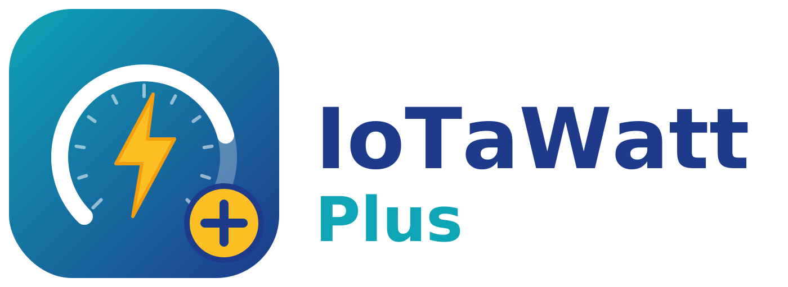
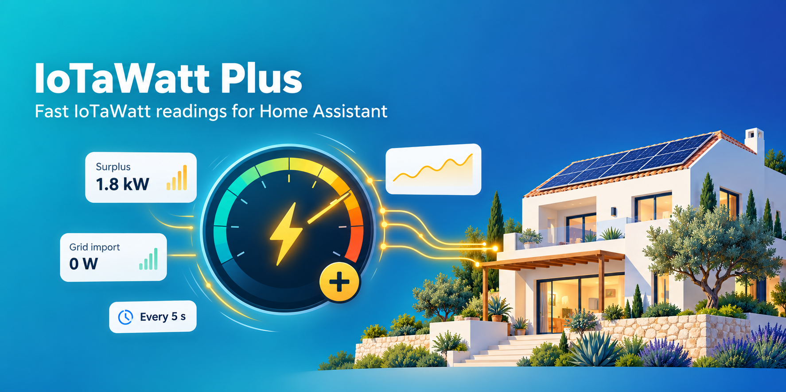

<p align="center">
  <picture>
    <source media="(prefers-color-scheme: dark)" srcset="custom_components/iotawatt_plus/brand/dark_logo@2x.png">
    
  </picture>
</p>

<p align="center">
  
</p>

# IoTaWatt Plus

[](https://hacs.xyz/)
[](https://github.com/jdgarcia99/ha-iotawatt-plus/actions/workflows/validate.yml)

A Home Assistant integration that reads an [IoTaWatt](https://iotawatt.com) energy monitor **every few seconds**, built for solar surplus management, while keeping the recorder database small.

The core IoTaWatt integration polls every 30 seconds. IoTaWatt Plus polls as often as every 2 seconds, exposes ready-to-use grid import/export and surplus sensors, and only stores a new state when the value really changes.

## Features

- **Power for every input and output** (for example `House` and `Solar`), every 5 s by default. Inputs are matched by channel number and outputs by name, never by position.
- **Accumulated energy (kWh) per channel**, from the IoTaWatt's own datalog. Exact, ready for the Energy dashboard, and kept across restarts: the energy used while Home Assistant was down is added when it starts again.
- **Grid and surplus sensors** from the signed grid channel:
  - *Grid import*: what you are buying now (W).
  - *Surplus*: what you are exporting now (W).
  - *Surplus average* over configurable windows (30 s, 1 min, 5 min by default), so automations don't react to every passing cloud.
- **Voltage and frequency.**
- **Diagnostics** (disabled by default): response time, Wi-Fi signal and uptime.
- **Database friendly.** Automations always see the latest reading, but a new state is only written when power changes by at least the configured deadband (10 W by default), or at least once per configured interval.
- **Gentle with the IoTaWatt.** Requests are never sent in parallel, and a failed request is retried once.
- **Fails safe.** An isolated failed reading keeps the last value; if the IoTaWatt stops answering for longer than *Store at least every*, sensors become *unavailable* instead of freezing on the last value.
- **Fully configurable from the UI**, both during setup and later from *Configure*.

## Installation

### HACS (recommended)

1. In HACS, open the menu (⋮) → **Custom repositories**.
2. Add `https://github.com/jdgarcia99/ha-iotawatt-plus` with category **Integration**.
3. Search for **IoTaWatt Plus**, install it and restart Home Assistant.

### Manual

Copy `custom_components/iotawatt_plus` into `/config/custom_components/` and restart Home Assistant.

## Setup

**Settings → Devices & services → Add integration → IoTaWatt Plus**, enter the IoTaWatt IP address or hostname, then review the settings.

## Settings

All settings can be changed later from **Settings → Devices & services → IoTaWatt Plus → Configure**.

| Setting | Default | Description |
|---|---|---|
| Power polling interval | 5 s | How often power is read (2–60 s). |
| Minimum change to store a value | 10 W | Deadband for writing a new power state. |
| Store at least every | 60 s | Maximum time without writing a state. |
| Grid channel | `Grid` | Signed channel: positive = importing, negative = exporting. |
| Surplus averaging windows | `30, 60, 300` | Seconds, comma separated. One sensor per window. |
| Channels | all | Inputs and outputs that get sensors. Removed channels are deleted. |
| Bidirectional channels | `Grid, PV1, PV2, Solar` | Comma separated. Channels whose energy can go down; they use `state_class: total`. |
| Channels without energy sensor | none | No energy sensor is created for these (the power sensor is kept). |
| Energy polling interval | 60 s | How often kWh totals are read. |
| Diagnostics polling interval | 5 min | Firmware, Wi-Fi and uptime. |
| Request timeout | 4 s | Maximum wait for each live reading (`/status`). |
| Datalog request timeout | 10 s | Maximum wait for each datalog request (`/query`). |

## Notes

- Energy sensors count from the moment the integration is added, and their totals are never reset.
- Energy is read in consecutive windows timed by the IoTaWatt's own clock, so it is exact even if that clock is not in sync with Home Assistant's. After a restart the total continues from its last value and the energy logged meanwhile is added (gaps longer than 31 days are not backfilled).
- Bidirectional channels (the grid channel is always one) use `state_class: total` and add negative energy with its sign. All other channels use `total_increasing` and ignore negative energy.
- Output channels that add up signed inputs may not make sense as an energy meter: list them in *Channels without energy sensor*.
- It can run alongside the core IoTaWatt integration, but the IoTaWatt answers better when only one integration polls it.

## Development

```bash
pip install -r requirements_test.txt
pytest tests
```

To check the API client against a real IoTaWatt (GET requests only, nothing is changed on the device; only `aiohttp` is needed):

```bash
python scripts/smoke_test.py <iotawatt-ip>
```

## License

MIT
